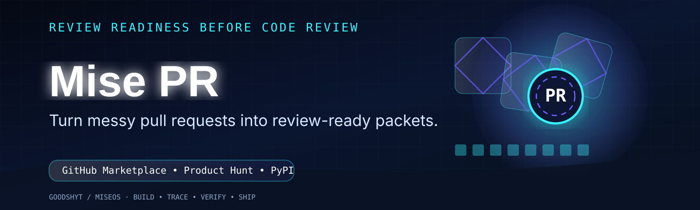

<p align="center">
  
</p>

<h1 align="center">Mise PR</h1>

<p align="center"><strong>Pull requests prepped before review.</strong></p>

<p align="center">
  <a href="docs/marketplace/MARKETPLACE_LISTING.md"></a>
  <a href="LICENSE"></a>
</p>

---

<br/>

<div align="center">

[](https://www.patreon.com/cw/GetitD)
[](https://opencollective.com/deontewattsv1)
[](https://ko-fi.com/deontewattsv1)
[](https://sonarcloud.io/organizations/deontewattsv1/)
[](https://crowdfunding.lfx.linuxfoundation.org/deontewattssV1)
[](https://liberapay.com/DeontewattsV1/)
[](https://issuehunt.io/profiles/deontewattsv1)
[](https://polar.sh/dashboard/deonte-watts)
[](https://buymeacoffee.com/deontewattsv1)
[](https://thanks.dev/e/gh/deontewattsv1)

</div>

## What is Mise PR?

**Mise PR** is a lightweight GitHub Action and CLI that turns messy pull requests into clean, review-ready packets before humans or AI agents review them.

It is **not another AI code reviewer**. It prepares the work before review begins.

Mise PR checks PR size, churn, risky paths, missing tests, weak descriptions, issue/spec links, changed-file shape, and estimated reviewer attention budget.

It outputs one Markdown packet for human reviewers and one JSON packet for AI agents, CI pipelines, and enterprise automation.

## Why this exists

AI coding agents made it easier to produce more code. They did not magically create more senior reviewer attention.

Most review tools ask: **Is this code good?**

Mise PR asks the earlier productivity question: **Is this PR actually reviewable yet?**

That is the wedge: **review readiness before review judgment**.

## Quick Start

Create `.github/workflows/mise-pr.yml` in the repository where you want to use Mise PR:
```yaml
name: Mise PR

on:
  pull_request:
    types: [opened, synchronize, reopened, edited]

permissions:
  contents: read
  pull-requests: read
  issues: write

jobs:
  review-packet:
    runs-on: ubuntu-latest
    steps:
      - uses: actions/checkout@v4
        with:
          fetch-depth: 0
      - name: Generate review packet
        uses: DeontewattsV1/mise-pr@v0.1.0
        with:
          base-ref: origin/${{ github.base_ref }}
          head-ref: HEAD
          fail-on: red
          comment: true
```

A copyable workflow example lives at [`docs/examples/workflows/mise-pr.yml`](docs/examples/workflows/mise-pr.yml).

## Local CLI

```bash
python -m pip install .
mise-pr analyze --base origin/main --head HEAD --output mise-pr-report.md --json-output mise-pr-report.json
```

## What it checks

| Signal | Why it matters |
|---|---|
| Files changed | Big PRs slow review and hide risk. |
| Churn | Large diffs require more reviewer attention. |
| Risky paths | Auth, payments, infra, migrations, secrets, and workflows need deliberate review. |
| Missing tests | Source changes without tests should be explained. |
| Weak PR description | Reviewers need intent, validation, and rollback context. |
| Missing issue/spec link | Reviewers need the original source of truth. |
| Attention budget | Teams need to know whether the PR fits a quick review or needs deeper focus. |

## Configuration

Create `.mise-pr.yml` in the repository using Mise PR:

```yaml
max_files: 12
max_churn: 450
max_single_file_churn: 180
require_issue_link: true
require_tests_for_source: true
require_description: true
risky_path_patterns:
  - auth
  - security
  - payment
  - billing
  - migration
  - github/workflows
```


## Architecture

Mise PR runs inside GitHub Actions. It reads local git metadata and the pull request event payload, scores review readiness, then writes Markdown and JSON outputs. No LLM is required. No source code is transmitted by default.

## Marketplace

Mise PR is packaged as a single-root GitHub Action with `action.yml` at the repository root. Marketplace launch copy, release instructions, and listing assets live in [`docs/marketplace`](docs/marketplace).

GitHub Marketplace publishing requires a GitHub Release where the owner selects **Publish this Action to the GitHub Marketplace**.

## Launch assets

The versioned visual system now lives with the source code and is packaged automatically for releases.

- README hero: [`docs/assets/product/readme-hero.svg`](docs/assets/product/readme-hero.svg)
- 16:9 launch graphic: [`docs/assets/product/launch-16x9.svg`](docs/assets/product/launch-16x9.svg)
- Interactive CodeArt trace demo: [`docs/assets/product/codeart-demo.html`](docs/assets/product/codeart-demo.html)
- Asset manifest: [`docs/assets/product/manifest.json`](docs/assets/product/manifest.json)
- Release packager: [`.github/workflows/release-visual-assets.yml`](.github/workflows/release-visual-assets.yml)
- Marketplace listing: [`docs/marketplace/MARKETPLACE_LISTING.md`](docs/marketplace/MARKETPLACE_LISTING.md)
- Release notes: [`docs/releases/v0.1.0.md`](docs/releases/v0.1.0.md)

Published GitHub Releases automatically receive rendered PNG copies of the SVG masters, `SHA256SUMS`, and ZIP/TAR visual bundles. A manual dispatch with a blank `release_tag` is package-only and preserves the same bundles as a GitHub Actions artifact. To backfill an existing release, enter its exact tag; the workflow validates that release, checks out the tag, builds from that historical revision, and attaches the generated visual bundles.

## License

Apache-2.0
